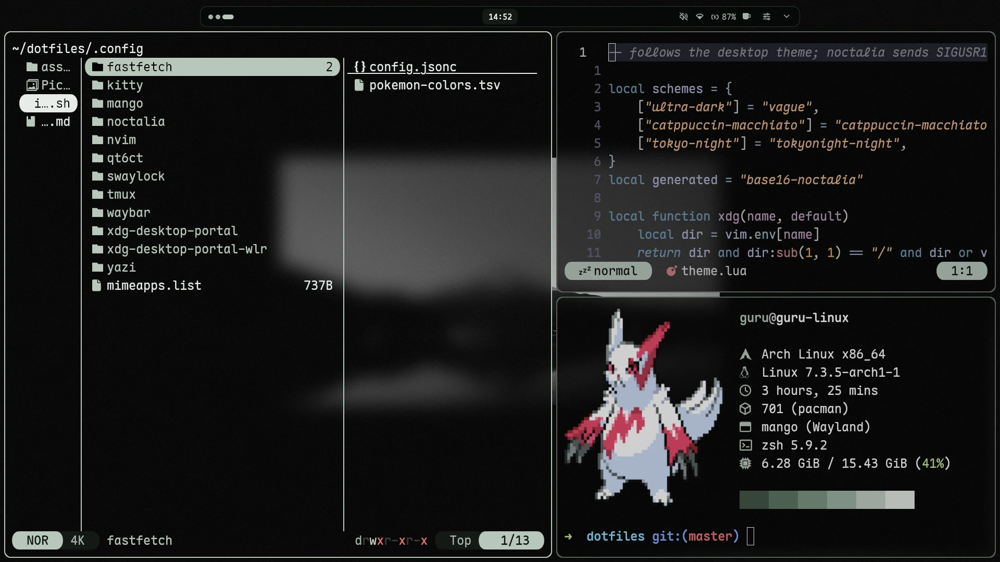
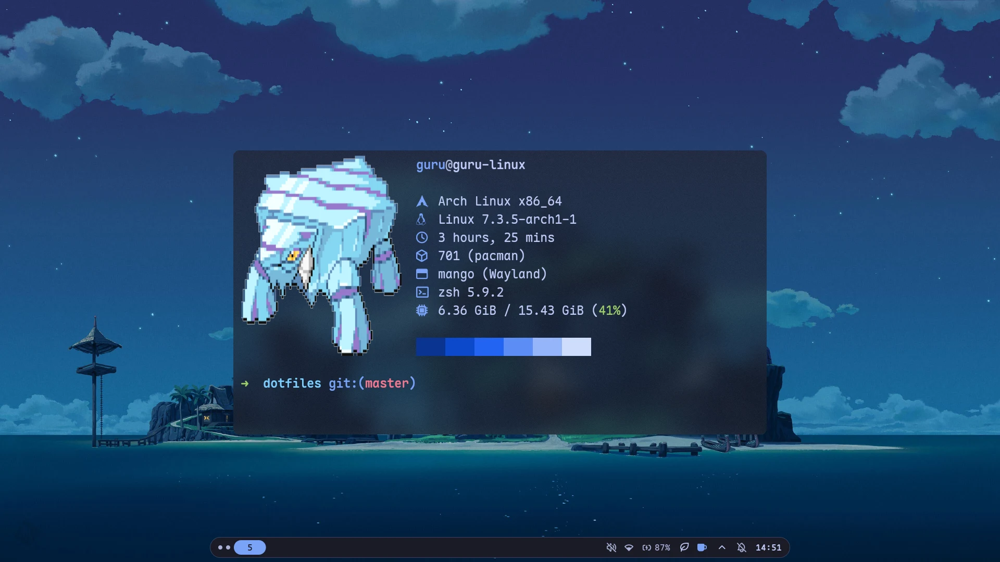
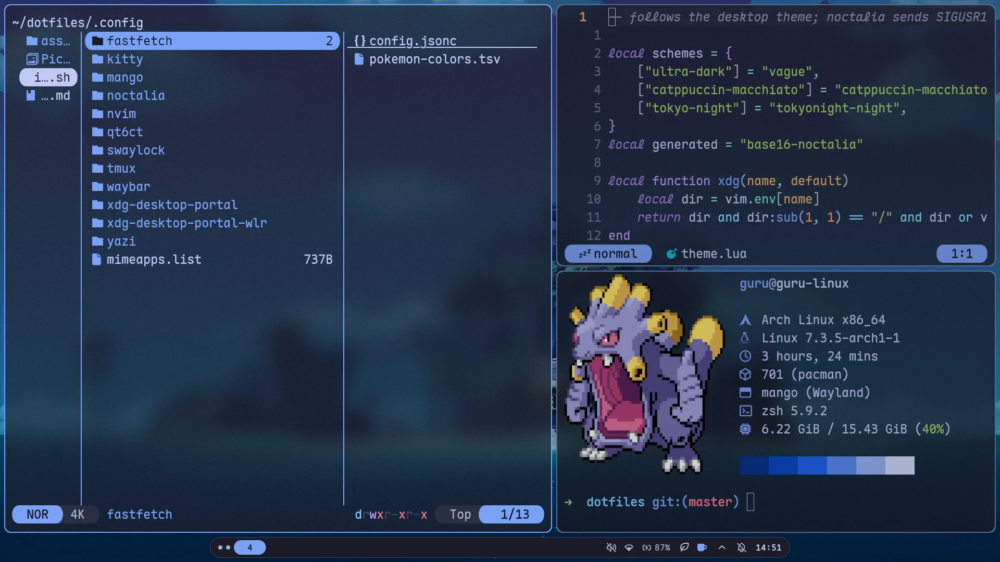
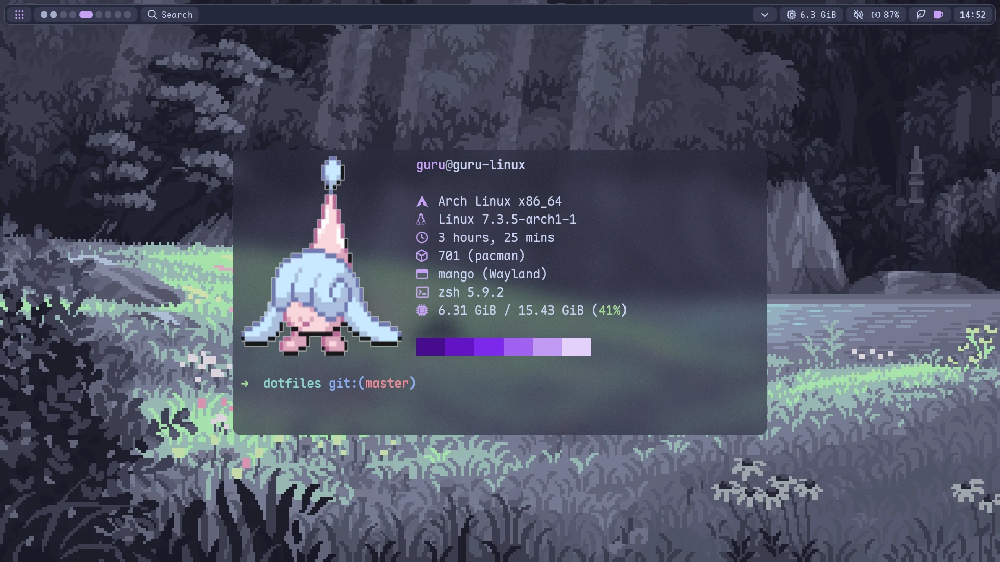
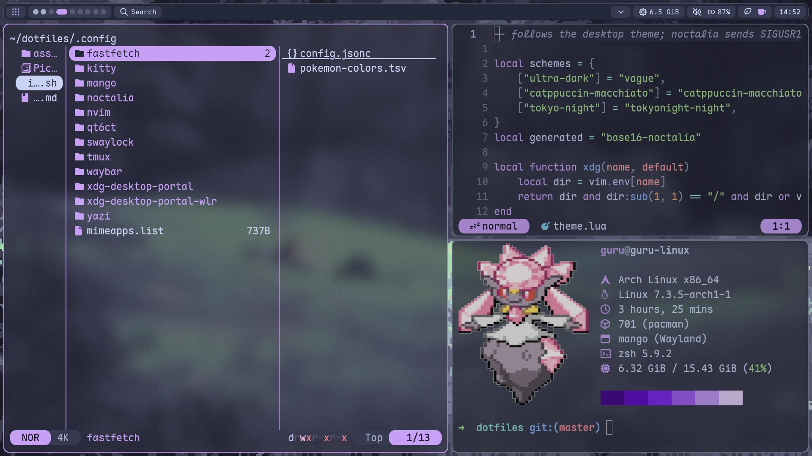
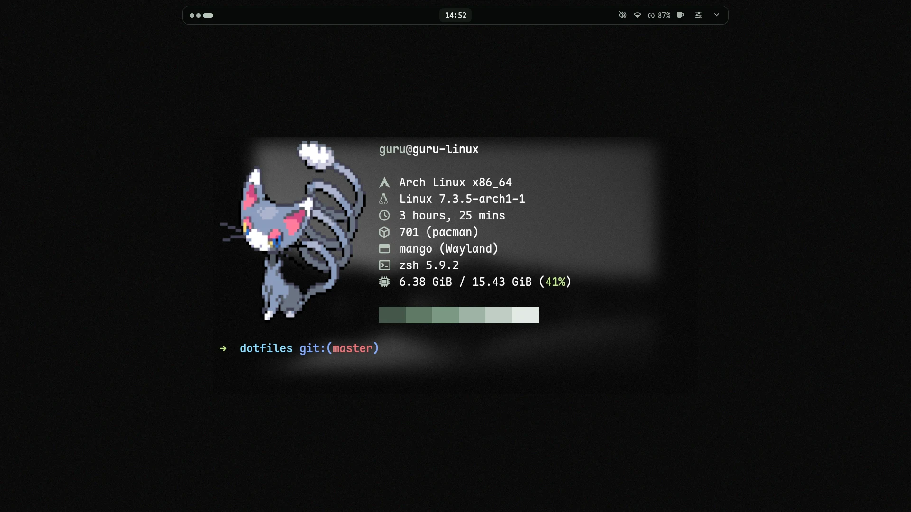
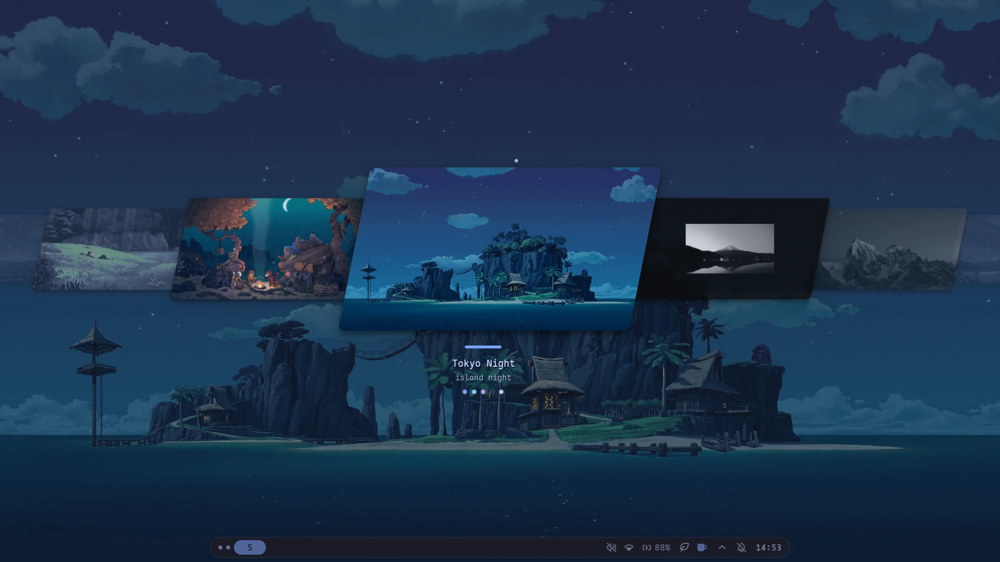

# dotfiles

My Arch setup. It runs [mango](https://github.com/DreamMaoMao/mangowc) as the
Wayland compositor and [Noctalia](https://github.com/noctalia-dev/noctalia-shell)
as the shell. There are three themes, and one command recolours the whole
desktop: bar, wallpaper, terminal, editor, file manager and git diffs.



| | |
| --- | --- |
|  |  |
|  |  |
|  | Tokyo Night, Catppuccin Macchiato, Ultra Dark |

## What's in here

| | |
| --- | --- |
| compositor | mango |
| bar, launcher, notifications | Noctalia, with my own bar layout for each theme |
| terminal | kitty, zsh with Oh My Zsh, tmux (prefix `Ctrl-a`) |
| editor | Neovim on lazy.nvim |
| files | yazi |
| font | Maple Mono NF |
| lock | swaylock + swayidle |
| greeting | fastfetch with a Pokémon sprite in the theme's colours |

```
.config/          app configs, stowed into ~/.config
.local/bin/       theme, pokesprite, powerboost, audio-switch, share-picker
Pictures/         fallback wallpaper
install.sh        sets up a fresh Arch install
assets/           screenshots (not stowed)
```

## Install

This is built for my laptop. Read `install.sh` before you run it.

Run `archinstall` first. It handles disks, the user, kernel, bootloader and
drivers. Then:

```sh
git clone https://github.com/gurukrithick/dotfiles ~/dotfiles
cd ~/dotfiles
./install.sh
```

It asks for sudo once and is safe to re-run. It does the following:

- installs yay, the pacman and AUR packages, rust, bun and uv
- installs Oh My Zsh and its plugins
- links everything into `$HOME` with `stow`
- sets up 8 GB of zram, puts `/tmp` on disk and sets a 1 second systemd-boot menu
- installs Docker but leaves it off at boot, and adds you to the `docker` group
- leaves networking to NetworkManager (iwd and systemd-networkd are disabled),
  with DNS through systemd-resolved and time sync through systemd-timesyncd
- enables the Noctalia login screen (greetd). It picks up the desktop's
  wallpaper and colours whenever they change
- adds a sudoers rule so `powerboost` can run from a keybind, plus a
  **passwordless sudo rule for your user**. Delete `install_agent_sudoers` from
  `main` if you don't want that.

Reboot afterwards and pick mango on the login screen. Logins, SSH keys and
Wi-Fi passwords aren't in here.

If the login screen ever breaks, press `Ctrl+Alt+F2`, log in, run
`sudo systemctl disable greetd` and reboot. Logging in on tty1 starts mango
straight from zsh.

To link the configs on a machine that's already set up:

```sh
stow -R -d ~/dotfiles -t ~ .
```

Wallpapers aren't in the repo because most aren't mine to share. Put two or
three in `~/Pictures/wallpapers/<theme>/` for each theme.

## Themes

```sh
theme set tokyo-night      # ultra-dark, catppuccin-macchiato
theme next                 # or prev
theme wallpaper next       # prev, random, or a path
theme list
```



You can also press `Super+Shift+T` to open a carousel of every wallpaper in
every theme. Stop on a card to preview it, and press Enter to keep it.
`Super+Ctrl+T` jumps straight to the next theme.

A switch updates:

- Noctalia's palette and bar layout, and the wallpaper (with a fade)
- kitty, plus everything that draws with its palette: fzf, yazi, delta and fastfetch
- Neovim (each theme maps to a real colour scheme, and open editors switch too)
- tmux, mango's borders, GTK 3/4, Qt via qt6ct, btop and bat

To add a theme, copy one of the files in `.config/noctalia/palettes/`, give it
a wallpaper folder, and optionally add a bar layout in
`.config/noctalia/bars/<id>.toml`.

## Keys

`Super` is the mod key. Plain `Super` handles windows and workspaces,
`Shift` opens things or moves the window, and `Ctrl` is for the system. All the
bindings are in [`.config/mango/config.conf`](.config/mango/config.conf).

| Keys | |
| --- | --- |
| `Super+Return` / `Super+T` | terminal |
| `Super+D` | launcher |
| `Super+C` | control center |
| `Super+Q` | close window |
| `Super+F` | fullscreen |
| `Super+H/J/K/L` | focus |
| `Super+Space` | next layout |
| `Super+1-9` | workspace |
| `Super+B` / `Super+N` | back / next busy workspace |
| `Super+,` / `Super+.` | focus the left / right monitor |
| `Super+Shift+B` | browser |
| `Super+Shift+C` | Chromium |
| `Super+Shift+E` | files |
| `Super+Shift+V` | clipboard history |
| `Super+Shift+A` | audio output |
| `Super+Shift+T` | theme carousel |
| `Super+Shift+S` | snip a region to the clipboard |
| `Super+Shift+R` | record the screen (drag a region or click a monitor; again to stop) |
| `Super+Shift+H/J/K/L` | swap windows |
| `Super+Shift+1-9` | move the window to a workspace |
| `Super+Ctrl+L` | lock |
| `Super+Ctrl+S` | lock and sleep |
| `Super+Ctrl+Q` | session menu |
| `Super+Ctrl+Shift+R` | reboot |
| `Super+Ctrl+Shift+P` | power off |
| `Super+Ctrl+R` | reload mango |
| `Super+Ctrl+B` | restart the bar |
| `Super+Ctrl+T` | next theme |

On two monitors, workspaces 1-5 go to the external screen and 6-9 to the
laptop. With one screen, all of them land there.

In Neovim the leader is `Space`. `<leader>ff` finds files, `<leader>fk` lists
every keymap, and `Ctrl-h/j/k/l` moves across splits and tmux panes.

## Thanks

- the [stdout](https://github.com/noctalia-dev/community-plugins) Noctalia plugin by tordex,
  vendored unchanged in `.config/noctalia/plugins/stdout`
- [vague.nvim](https://github.com/vague2k/vague.nvim),
  [catppuccin](https://github.com/catppuccin/nvim) and
  [tokyonight.nvim](https://github.com/folke/tokyonight.nvim)
- Pokémon sprites from [PokeAPI](https://github.com/PokeAPI/sprites)
